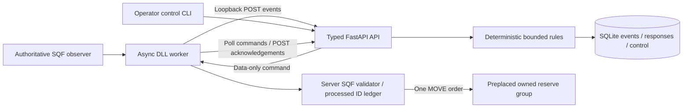

<!-- SPDX-License-Identifier: Apache-2.0 -->
# Local bounded response architecture

This milestone implements part of #2/#5/#8/#9/#10/#13. It stops at one deterministic
reserve response. The prior observation path passed an operator Eden/outage playtest;
the new executor still requires [live verification](local-demo.md).



Arma owns world state, group eligibility, locality, validation and order assignment.
`response.py` owns the deterministic rule, lifecycle and one-commitment budget.
`storage.py` records the observation and decision in the same writer transaction;
event retries cannot make another decision. `models.py` forbids extra properties.
SQLite writes serialize approvals, issue and acknowledgement. No provider is invoked.
The observation inspector and simulation/mock remain available; no SITREP formatter
exists in this baseline. Rules do not create a general faction intelligence layer.

## Rules and operator boundary

The only action is `dispatch_reserve`, asset `reserve_alpha`, location
`response_alpha`. Neither coordinates, unit classes nor SQF can be supplied by the
director. Mission setup owns the checkpoint guards; the response reserve is placed
in `mission.sqm`, with no command-time spawning. Reserve PATH AI is disabled until
an accepted command to keep recommendation-only tests stationary.

An attack means positive checkpoint guard Hit or Killed, throttled to once per 3s.
Only `checkpoint_alpha` with a reported BLUFOR attacker can recommend dispatch;
UNKNOWN, other checkpoints, stale (>120s), future (>5s), paused, cooling down,
already approved or committed conditions produce durable `no_action` reasons.
Cooldown defaults to 15s and is configured by `OVERLORD_RESPONSE_COOLDOWN_SECONDS`.
It applies from a recommendation, not every rejected event. The rule proposes only
one reserve; Arma performs the actual eligibility check at execution time.

New sessions default to recommendation-only (`enabled=false`, `paused=false`).
`PUT /v1/sessions/{uuid}/control` takes `{ "enabled": true, "paused": false }`.
Use `python -m overlord.control --session UUID status|enable|disable|pause|resume`.
Every actual mode change expires undispatched proposals/approvals and sets a fresh
event-time boundary. Repeating an identical control request is idempotent. Enabling
requires a fresh attack after that boundary and cooldown; old or buffered pre-enable
attacks never become dispatches. The control state persists across director restart.

Pause prevents new dispatch, including retries while paused. It cannot recall a
command already returned into transport, or stop an assigned waypoint. Set
`OL_localPaused=true` on the authoritative game machine for an immediate local
veto; change an already-issued order using Zeus/editor controls. The executor
never reapplies waypoints when receiving a duplicate. Revoking the group's
`OL_owned` flag opts it out. No locality transfer or arbitrary remoteExec is used.

## Command, wire and acknowledgement contracts

Observation protocol 1.0 is unchanged. New JSON commands are closed typed objects:

```json
{
  "protocol_version": "1.0",
  "session_id": "f32b654e-7c36-42f0-8a77-d2411d1f488c",
  "command_id": "7d37bd70-2233-5292-8e81-d36bbab71b8f",
  "idempotency_key": "7d37bd70-2233-5292-8e81-d36bbab71b8f",
  "triggering_event": "025670d7-9d6e-4913-b0e7-81f144e67322",
  "action": "dispatch_reserve",
  "asset": "reserve_alpha",
  "location": "response_alpha",
  "expires_at": "2026-11-09T12:02:00Z"
}
```

Identity is UUIDv5 from session + event + configured asset. Key equals command ID.
Session registration supplies immutable mission metadata. Expiry is rounded down to
a UTC minute 60–120s ahead; Arma checks UTC, not accelerated mission time.

`GET /v1/sessions/{uuid}/responses` exposes mode, every attack decision, event UUID,
reason, command, commitment, state and actual ack. `POST /v1/commands/poll` accepts
`{"session_id":"UUID"}` and returns the bounded SQF data-array representation:

```text
["1.0", session_uuid, enabled, paused,
 [command_uuid, idempotency_key, "dispatch_reserve", "reserve_alpha",
  "response_alpha", [UTC_year, month, day, hour, minute]], status]
```

No command uses `[]` in slot 4. The response carries the last decision status;
full explanations and trigger evidence are in the response view. Only one command
is delivered per poll. JSON arrays/booleans are parsed with `parseSimpleArray`, never
`compile`. The bridge downloads at most 1024 bytes on command polls and wraps the
packet as `[http_status, packet]`. Existing event/session status-only polls remain
compatible. Every request uses the same finite worker queue; SQF yields while waiting.

`POST /v1/acknowledgements` accepts version, session UUID, command UUID, key, status
(`executed|rejected|expired|failed`) and an allowlisted result code (OpenAPI defines
all codes). `executed` requires `movement_order_assigned`: this acknowledges order
assignment, never arrival. Identical ack retries return 200; changed acknowledgements,
unknown commands, wrong session/key or acknowledgements before issue return 409
(unknown sessions 404). Validation errors return 422 without echoing input.

## Lifecycle, failure and restart

| State | Meaning |
| --- | --- |
| proposed | Recommendation only, never retrievable for execution |
| approved | Fresh eligible event while enabled; awaiting retrieval |
| issued | Retrieval committed the session reserve budget before HTTP response |
| executed | Arma reports movement order assignment |
| rejected / expired / failed | Arma result, or unissued proposal expiry |
| uncertain | Issued command expired without acknowledgement; it may have run |
| no_action | Deliberate unsuitable-condition result |

Issue consumes the reserve commitment even if transport fails, Arma rejects, or
execution fails. It is never released automatically. Retries before expiry return
only the same command. No second approved command can be created concurrently.
After expiry, unresolved issue becomes uncertain and is no longer sent. A late
actual acknowledgement may resolve uncertainty. The operator must inspect, rather
than reissue under a new identity. This favours missed responses over double orders;
it does **not** promise exactly-once execution.

SQF validates server authority, active session/version, identity/key, expiry,
allowlisted references, enabled/paused state, local veto, budget, live OPFOR group,
no players, integration ownership, group locality, no added human waypoints and the
configured marker position. Validation/latch/assignment runs unscheduled. It records
ID and commitment **before** waypoint mutation; duplicates resend the recorded ack,
without applying another order. An interrupted mutation retains a failed/uncertain
record. Eligible execution enables PATH once, adds one MOVE waypoint and selects it.
Subsequent Zeus/editor changes are not overwritten. References for engine semantics:
[local](https://community.bistudio.com/wiki/local),
[addWaypoint](https://community.bistudio.com/wiki/addWaypoint),
[setCurrentWaypoint](https://community.bistudio.com/wiki/setCurrentWaypoint), and
[dateToNumber](https://community.bistudio.com/wiki/dateToNumber).

Director downtime cannot block gameplay: the DLL owns HTTP waits, SQF yields, and
outbox retries retain IDs. A director restart with the same SQLite file restores
mode, responses, commitment and unresolved identities. The game retains processed
IDs/acks in mission memory. A fresh game session has a fresh UUID and defaults off.
Saved-game rollback/load continuity is unsupported; restart the scenario instead.
Deleting the DB loses audit history; the active game commitment still prevents a
second order, but restoring state must not be inferred from an empty database.

Migration 2 adds response/control tables without changing migration 1 or existing
observations. Startup applies ordered migrations transactionally via `user_version`;
newer unknown schemas fail startup. Back up SQLite with service stopped before
upgrading; restore backup to downgrade. Events remain append-only; response rows
materialize their latest lifecycle/result (not a separate append-only transition
journal). Retention/redaction remains operator managed: no automatic purge, no player
identity collection. Preserve records for an unresolved mission. This is for modest
local demo traffic and a trusted loopback host, without authentication.

HostHavoc, dedicated multiplayer, headless ownership migration, remote HTTPS/auth,
native webRequest selection, wider action APIs, paid inference, tactical planning,
campaign systems, third-party integrations and billing remain outside this milestone.
See [transport evidence](transport-local.md) and [verification](verification.md).

## Implemented initial observation contract v1.0

The working schema and version validation remain unchanged. Ecosystem research under
[#25](https://github.com/instanceofjamie/overlord/issues/25) and actual SQF observation requirements under [#6](https://github.com/instanceofjamie/overlord/issues/6)/[#8](https://github.com/instanceofjamie/overlord/issues/8)
should inform its evolution before broader integration interfaces are finalised.

Register a UUID session via `POST /v1/sessions` with `mission_name` and `map_name`
(strings of 1–128 characters). Repeating identical registration is safe; changed
metadata under the same ID returns 409. Each mission run uses a new session UUID.

Submit `POST /v1/observations`:

```json
{
  "protocol_version": "1.0",
  "session_id": "f32b654e-7c36-42f0-8a77-d2411d1f488c",
  "event_id": "025670d7-9d6e-4913-b0e7-81f144e67322",
  "event_type": "checkpoint_attacked",
  "timestamp": "2026-11-07T11:00:00Z",
  "payload": {
    "checkpoint_id": "checkpoint_alpha",
    "attacking_side": "BLUFOR"
  }
}
```

Every envelope field is required. Timestamps require a timezone; they describe
reported occurrence time, not trusted server time. `mission_started` instead
requires payload `{"player_count": 4}` (strict integer 0–256). Checkpoint IDs
are 1–64 word/dot/hyphen characters. Sides are BLUFOR, OPFOR, INDEPENDENT or UNKNOWN.
Extra properties, arbitrary SQF, unsupported versions/types and mismatched payloads
return 422. The OpenAPI schema at `/openapi.json` is the machine-readable contract.

An unknown session returns 404. Successful recording returns 201 with event ID and
`recorded`; an identical validated event ID replay returns 200 and `duplicate`.
Event IDs are globally unique: reuse with different contents or session returns
409. Retrying an uncertain delivery must reuse the original ID and contents.
Transactions make concurrent retries safe. Events are append-only through the API.

`GET /v1/sessions/{session_id}/observations?offset=0&limit=100` returns receipt
order, with limit 1–100 and nonnegative offset. Delayed or out-of-order events are
accepted as reported observations; timestamps do not reorder receipts or establish faction knowledge. The bounded
response rule rejects stale/future and pre-enable evidence. A checkpoint event need not wait for mission_started delivery.
