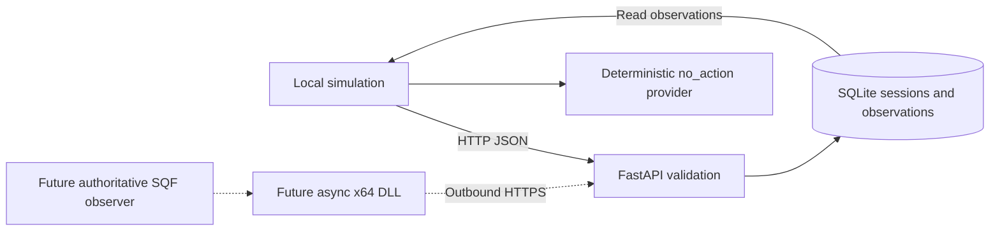

<!-- SPDX-License-Identifier: Apache-2.0 -->
# Director foundation

Implemented in the first Python slice for #7; partial groundwork for #2, #8,
#9 and #10. This is an observation recorder, not a playable AI director.



## Implemented components

- `config.py`: Pydantic environment settings, `.env` support, mock-only provider.
- `models.py`: closed, discriminated observation schemas. Unknown fields are rejected.
- `api.py`: application factory and lifespan initialization, health/version, session
  registration, event ingestion and bounded observation retrieval. Synchronous
  endpoints run SQLite work in FastAPI's worker pool.
- `storage.py`: SQLite transactions, foreign keys, unique event IDs and receipt order.
  Each operation owns and closes its connection; writes use `BEGIN IMMEDIATE`
  and a five-second lock timeout. Storage errors return 503, not success.
- `providers.py`: typed provider interface and a pure deterministic no-op mock.
  Ingestion never invokes inference. The CLI calls the mock locally to demonstrate
  restraint; no decision is persisted or exposed as an executable command.
- `simulate.py`: finite HTTP client with timeouts and a fresh sample session per run.
- `logging.py`: JSON application logs with timestamp, level and event correlation
  IDs; payloads, prompts, environment and credentials are not logged. Validation
  errors do not echo submitted values. Uvicorn access logging is disabled.

## Observation contract v1.0

Register a UUID session via `POST /v1/sessions` with `mission_name` and `map_name`
(strings of 1–128 characters). Repeating identical registration is safe; changed
metadata under the same ID returns 409. Each mission run uses a new session UUID.

Submit `POST /v1/observations`:

```json
{
  "protocol_version": "1.0",
  "session_id": "f32b654e-7c36-42f0-8a77-d2411d1f488c",
  "event_id": "025670d7-9d6e-4913-b0e7-81f144e67322",
  "event_type": "checkpoint_attacked",
  "timestamp": "2026-11-07T11:00:00Z",
  "payload": {
    "checkpoint_id": "checkpoint_alpha",
    "attacking_side": "BLUFOR"
  }
}
```

Every envelope field is required. Timestamps require a timezone; they describe
reported occurrence time, not trusted server time. `mission_started` instead
requires payload `{"player_count": 4}` (strict integer 0–256). Checkpoint IDs
are 1–64 word/dot/hyphen characters. Sides are BLUFOR, OPFOR, INDEPENDENT or UNKNOWN.
Extra properties, arbitrary SQF, unsupported versions/types and mismatched payloads
return 422. The OpenAPI schema at `/openapi.json` is the machine-readable contract.

An unknown session returns 404. Successful recording returns 201 with event ID and
`recorded`; an identical validated event ID replay returns 200 and `duplicate`.
Event IDs are globally unique: reuse with different contents or session returns
409. Retrying an uncertain delivery must reuse the original ID and contents.
Transactions make concurrent retries safe. Events are append-only through the API.

`GET /v1/sessions/{session_id}/observations?offset=0&limit=100` returns receipt
order, with limit 1–100 and nonnegative offset. Delayed or out-of-order events are
accepted as facts; timestamps do not trigger actions, reorder receipts or establish
faction knowledge. A checkpoint event need not wait for mission_started delivery.

## Persistence and migrations

The default file is `var/overlord.sqlite3`. Startup applies ordered SQL migrations
inside one transaction using SQLite `user_version`; repeated startup is safe.
A newer schema fails startup rather than attempting a downgrade. Add migrations
instead of changing applied statements. Back up the database while the service is
stopped before upgrading; restore that backup to roll back. No automatic destructive
migration, deletion, compaction or retention schedule is implemented. Session and
event JSON and receipt timestamps persist across restart. Operators currently own
backup/retention and log rotation. No player identities or game assets are collected.
This is intended for one local service process and modest event volumes.

## Planned game boundary and trust

Arma remains authoritative. Future server-side SQF observes significant events;
execution and multiplayer locality stay on the authoritative server/owning machine.
An independently deployed Python service must never be required on HostHavoc.
A future DLL must enqueue bounded work and return promptly from `callExtension`;
HTTP, retry and inference waits belong on workers. The game continues on disconnect.
Use outbound HTTPS for event submission and eventual polling for proposals; no
incoming game-server connection is assumed. Native loading is provisionally
permitted, but outbound HTTPS and deployment policy remain unconfirmed (#22).
The proof checklist in [FinOps](finops.md) must precede real deployment.

The future bridge needs bounded queues, timeouts, backoff, stable IDs, expiry and
diagnostics. Its commands must be allowlisted typed proposals with bounded
arguments, idempotency keys, expiry, authoritative SQF validation and execution
acknowledgements (#8/#13). It must never accept arbitrary SQF. Human Zeus inspection,
pause, cancellation and override are required before autonomous execution. The
receipt log is an initial audit trail; command lifecycle and decisions are future work.

The director's observation log is not faction intelligence. A future deliberation
layer must select bounded, authorised faction knowledge rather than hand this
entire log to enemy planning (#16). No tactical reasoning is implemented here.

If host transport is blocked, a trusted human Zeus client relay is a contingency,
requiring explicit server-side role/owner checks, CfgRemoteExec allowlisting,
schemas, cooldowns and idempotency. RCon alone is not a general SQF RPC interface.
These are design requirements, not implemented or verified game integrations.

This iteration has no authentication and binds to loopback by default. Remote
operation requires a separate authenticated HTTPS transport design before exposure;
the current API is for trusted local development. Body-level network quotas,
transport authentication and replay policy beyond ID deduplication remain open.

## Cost boundary and next increments

Only the mock is configurable; there is no AWS SDK, infrastructure or paid call.
Before adding a paid provider (#14/#19), implement per-session/month budgets,
conservative in-flight reservations, token/invocation accounting, cooldowns,
rate/concurrency bounds and deterministic fallback. The proposed £5/month target
in FinOps is not enforced by this recorder. Independent hosting and inference are
separate costs; no cloud standing resources are required.

Next: review/freeze observation semantics with SQF needs (#6/#8), then expand durable
state and command lifecycle (#9) and the bounded mock decision loop (#10). Host
compatibility (#22) and mission acceptance (#3) remain separate verification gates.
No Arma, extension, Bedrock, dialogue, campaign, Antistasi, SaaS or billing is included.
