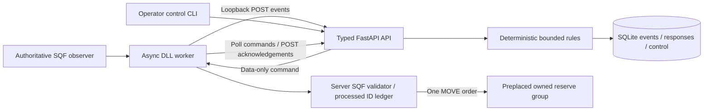

<!-- SPDX-License-Identifier: Apache-2.0 -->
# Local bounded response architecture

Current dedicated-server authority and remaining two-client checks are documented
in [the dedicated guide](local-dedicated.md) and the dated repair section below.

This milestone implements part of #2/#5/#8/#9/#10/#13. It stops at one deterministic
reserve response. The prior observation path passed an operator Eden/outage playtest;
the new executor still requires [live verification](local-demo.md).

## Playable operation and supported operator workflow — 2026-11-09

The local operation extends the bounded loop below. `flow.sqf` contains the pure
transition function used by server progression; `operation.sqf` validates the player,
life state, current phase and required marker distance before accepting an action.
It uses the documented [corpse-aware isPlayer syntax](https://community.bistudio.com/wiki/isPlayer)
for player identity so the death handler can report a terminal failure.
`initPlayerLocal.sqf` creates three tasks once, updates their states once per phase,
and adds the normal action-menu interactions and diary. No timer starts combat.

| Current phase | Accepted interaction/evidence | Next phase |
| --- | --- | --- |
| briefing | Begin patrol at friendly_base, alive, within 30m | recon |
| recon | Explicit recon report at recon_alpha, alive, within 20m | extraction |
| extraction | Extract at extraction_alpha, alive, within 30m | succeeded |
| recon / extraction | Explicit abort at extraction, within 30m | failed |
| any nonterminal | Player killed | failed |
| any | Repeated/invalid interaction | Unchanged |

Checkpoint harm is an orthogonal milestone; it never completes reconnaissance,
forces engagement or changes a successful outcome. `operation_progress` observations
carry a closed milestone enum and the existing UUID/time/session envelope. Python's
`operation.py` replays accepted progression in receipt order; invalid/out-of-order
milestones remain stored evidence but do not create success. Terminal progression
expires undispatched responses; command polling stops new dispatch after completion.
The authoritative game also rejects late commands with `operation_complete`.

**Actual previous cause:** the 12:51 and 12:54 logs showed proposals with execution
disabled. The intended per-session default, a CLI-only control, using an ended session
UUID, and running system Python instead of the project environment caused friction.
There was no missing application role: the previous loopback API was unauthenticated.
This change adds the missing supported control surface and a limited authentication
boundary rather than automatically granting authority to every caller.

The normal CLI launcher generates a random 32-byte URL-safe operator credential per
service run (or uses private `OVERLORD_OPERATOR_TOKEN`) and prints a private panel
link with a fragment credential. The public HTML does not contain it. The fragment
is removed from the URL and retained in tab session storage; mutation requests use
Bearer authentication. Constant-time comparison protects `/control` and `/approve`;
missing/wrong credentials return 403, an unconfigured service returns 503, and foreign
browser origins are rejected. Read-only status explains the permission boundary.
The normal Windows/WSL launch scripts select the correct project environment.
Game ingestion, polling and acknowledgements still assume a trusted local host:
this is not remote transport authentication and must not be publicly exposed.

Control adds `observation_only` and `automatic`. Defaults are recommendation-only;
`enabled=true, automatic=false` permits fresh recommendations to be reviewed and
explicitly approved by command UUID. Automatic mode keeps the previous eligible
fresh-event behaviour. Every actual mode change still expires undispatched proposals
and advances the evidence boundary. Approval checks enabled/not paused, live expiry,
freshness and budget in the same SQLite writer transaction. It records approval time
and kind; issue and ack receive times are also retained in response JSON. No new
schema migration is needed; old JSON defaults conservatively and old approval
metadata is displayed as unrecorded rather than invented.

**Minimal knowledge boundary:** `checkpoint_attacked` now includes `report_channel`
(`guard_radio|none|legacy_unverified`) and `reserve_available`. The mission emits a
guard radio report only when a conscious living checkpoint guard can report the
harm. This is an instantaneous local radio abstraction, not realistic range/delay,
jamming or false-report simulation. Old unproven telemetry defaults unverified and
cannot authorize a reserve. Unknown attacker or unavailable reserves yields no action.
`debrief.faction_reports` is a separate materialized view of those guard reports,
with event UUID, source, age/time, checkpoint reference and reported confidence;
it contains no player position. Director recon/progress facts are not copied there.
Arma's native perception continues normally; no `reveal` or forced detection is used.

The normal AAR combines local observed progress/executor results with a labelled
last-received director snapshot. A command poll may request `include_report=true`:
slot 6 is then a bounded list of factual report lines. Without that flag the original
six-slot wire remains. The bridge response cap is now 2048 bytes. No report text is
compiled. The panel's readable debrief uses the stored event record, proposals,
approvals and real acks; arrival remains untracked. Offline/local records never
pretend to be persisted, and missing results remain unknown. The local outbox is
32 entries, with attacks capped at 24 to reserve progress/ack space; it is not durable
across scenario exit. The mission stays running after debrief so delivery can finish.

This is **single-player local Eden preview**, not a new multiplayer/remote execution
interface. The three task objects and action authority are local/server scoped.
Four roles, dedicated play, Headless Client migration and HostHavoc remain subsequent
work. See [startup, permissions and both playtests](local-demo.md).

## Bounded response contract reference

The details below describe the retained response loop, with the additions above.



Arma owns world state, group eligibility, locality, validation and order assignment.
`response.py` owns the deterministic rule, lifecycle and one-commitment budget.
`storage.py` records the observation and decision in the same writer transaction;
event retries cannot make another decision. `models.py` forbids extra properties.
SQLite writes serialize approvals, issue and acknowledgement. No provider is invoked.
The observation inspector and simulation/mock remain available; no SITREP formatter
exists in this baseline. Rules do not create a general faction intelligence layer.

## Rules and operator boundary

The only action is `dispatch_reserve`, asset `reserve_alpha`, location
`response_alpha`. Neither coordinates, unit classes nor SQF can be supplied by the
director. Mission setup owns the checkpoint guards; the response reserve is placed
in `mission.sqm`, with no command-time spawning. Reserve PATH AI is disabled until
an accepted command to keep recommendation-only tests stationary.

An attack means positive checkpoint guard Hit or Killed, throttled to once per 3s.
Only `checkpoint_alpha` with a reported BLUFOR attacker, guard radio report and
available reserve can recommend dispatch;
UNKNOWN, other checkpoints, stale (>120s), future (>5s), paused, cooling down,
already approved or committed conditions produce durable `no_action` reasons.
Cooldown defaults to 15s and is configured by `OVERLORD_RESPONSE_COOLDOWN_SECONDS`.
It applies from a recommendation, not every rejected event. The rule proposes only
one reserve; Arma performs the actual eligibility check at execution time.

New sessions default to recommendation-only (`enabled=false`, `paused=false`).
`PUT /v1/sessions/{uuid}/control` takes `{ "enabled": true, "paused": false }`.
Use `python -m overlord.control --session UUID status|enable|disable|pause|resume`.
Every actual mode change expires undispatched proposals/approvals and sets a fresh
event-time boundary. Repeating an identical control request is idempotent. Enabling
requires a fresh attack after that boundary and cooldown; old or buffered pre-enable
attacks never become dispatches. The control state persists across director restart.

Pause prevents new dispatch, including retries while paused. It cannot recall a
command already returned into transport, or stop an assigned waypoint. Set
`OL_localPaused=true` on the authoritative game machine for an immediate local
veto; change an already-issued order using Zeus/editor controls. The executor
never reapplies waypoints when receiving a duplicate. Revoking the group's
`OL_owned` flag opts it out. No locality transfer or arbitrary remoteExec is used.

## Command, wire and acknowledgement contracts

Observation protocol 1.0 is unchanged. New JSON commands are closed typed objects:

```json
{
  "protocol_version": "1.0",
  "session_id": "f32b654e-7c36-42f0-8a77-d2411d1f488c",
  "command_id": "7d37bd70-2233-5292-8e81-d36bbab71b8f",
  "idempotency_key": "7d37bd70-2233-5292-8e81-d36bbab71b8f",
  "triggering_event": "025670d7-9d6e-4913-b0e7-81f144e67322",
  "action": "dispatch_reserve",
  "asset": "reserve_alpha",
  "location": "response_alpha",
  "expires_at": "2026-11-09T12:02:00Z"
}
```

Identity is UUIDv5 from session + event + configured asset. Key equals command ID.
Session registration supplies immutable mission metadata. Expiry is rounded down to
a UTC minute 60–120s ahead; Arma checks UTC, not accelerated mission time.

`GET /v1/sessions/{uuid}/responses` exposes mode, every attack decision, event UUID,
reason, command, commitment, state and actual ack. `POST /v1/commands/poll` accepts
`{"session_id":"UUID"}` and returns the bounded SQF data-array representation:

```text
["1.0", session_uuid, enabled, paused,
 [command_uuid, idempotency_key, "dispatch_reserve", "reserve_alpha",
  "response_alpha", [UTC_year, month, day, hour, minute]], status]
```

No command uses `[]` in slot 4. The response carries the last decision status;
full explanations and trigger evidence are in the response view. Only one command
is delivered per poll. JSON arrays/booleans are parsed with `parseSimpleArray`, never
`compile`. The bridge downloads at most 2048 bytes on command polls and wraps the
packet as `[http_status, packet]`. Existing event/session status-only polls remain
compatible. Every request uses the same finite worker queue; SQF yields while waiting.

`POST /v1/acknowledgements` accepts version, session UUID, command UUID, key, status
(`executed|rejected|expired|failed`) and an allowlisted result code (OpenAPI defines
all codes). `executed` requires `movement_order_assigned`: this acknowledges order
assignment, never arrival. Identical ack retries return 200; changed acknowledgements,
unknown commands, wrong session/key or acknowledgements before issue return 409
(unknown sessions 404). Validation errors return 422 without echoing input.

## Lifecycle, failure and restart

| State | Meaning |
| --- | --- |
| proposed | Recommendation only, never retrievable for execution |
| approved | Fresh eligible event while enabled; awaiting retrieval |
| issued | Retrieval committed the session reserve budget before HTTP response |
| executed | Arma reports movement order assignment |
| rejected / expired / failed | Arma result, or unissued proposal expiry |
| uncertain | Issued command expired without acknowledgement; it may have run |
| no_action | Deliberate unsuitable-condition result |

Issue consumes the reserve commitment even if transport fails, Arma rejects, or
execution fails. It is never released automatically. Retries before expiry return
only the same command. No second approved command can be created concurrently.
After expiry, unresolved issue becomes uncertain and is no longer sent. A late
actual acknowledgement may resolve uncertainty. The operator must inspect, rather
than reissue under a new identity. This favours missed responses over double orders;
it does **not** promise exactly-once execution.

SQF validates server authority, active session/version, identity/key, expiry,
allowlisted references, enabled/paused state, local veto, budget, live OPFOR group,
no players, integration ownership, group locality, no added human waypoints and the
configured marker position. Validation/latch/assignment runs unscheduled. It records
ID and commitment **before** waypoint mutation; duplicates resend the recorded ack,
without applying another order. An interrupted mutation retains a failed/uncertain
record. Eligible execution enables PATH once, adds one MOVE waypoint and selects it.
Subsequent Zeus/editor changes are not overwritten. References for engine semantics:
[local](https://community.bistudio.com/wiki/local),
[addWaypoint](https://community.bistudio.com/wiki/addWaypoint),
[setCurrentWaypoint](https://community.bistudio.com/wiki/setCurrentWaypoint), and
[dateToNumber](https://community.bistudio.com/wiki/dateToNumber).

Director downtime cannot block gameplay: the DLL owns HTTP waits, SQF yields, and
outbox retries retain IDs. A director restart with the same SQLite file restores
mode, responses, commitment and unresolved identities. The game retains processed
IDs/acks in mission memory. A fresh game session has a fresh UUID and defaults off.
Saved-game rollback/load continuity is unsupported; restart the scenario instead.
Deleting the DB loses audit history; the active game commitment still prevents a
second order, but restoring state must not be inferred from an empty database.

Migration 2 adds response/control tables without changing migration 1 or existing
observations. Startup applies ordered migrations transactionally via `user_version`;
newer unknown schemas fail startup. Back up SQLite with service stopped before
upgrading; restore backup to downgrade. Events remain append-only; response rows
materialize their latest lifecycle/result (not a separate append-only transition
journal). Retention/redaction remains operator managed: no automatic purge, no player
identity collection. Preserve records for an unresolved mission. This is for modest
local traffic and a trusted loopback host; operator mutations now require the
launch credential described above.

HostHavoc, dedicated multiplayer, headless ownership migration, remote HTTPS/auth,
native webRequest selection, wider action APIs, paid inference, tactical planning,
campaign systems, third-party integrations and billing remain outside this milestone.
See [transport evidence](transport-local.md) and [verification](verification.md).

## Implemented initial observation contract v1.0

The working schema and version validation remain unchanged. Ecosystem research under
[#25](https://github.com/instanceofjamie/overlord/issues/25) and actual SQF observation requirements under [#6](https://github.com/instanceofjamie/overlord/issues/6)/[#8](https://github.com/instanceofjamie/overlord/issues/8)
should inform its evolution before broader integration interfaces are finalised.

Register a UUID session via `POST /v1/sessions` with `mission_name` and `map_name`
(strings of 1–128 characters). Repeating identical registration is safe; changed
metadata under the same ID returns 409. Each mission run uses a new session UUID.

Submit `POST /v1/observations`:

```json
{
  "protocol_version": "1.0",
  "session_id": "f32b654e-7c36-42f0-8a77-d2411d1f488c",
  "event_id": "025670d7-9d6e-4913-b0e7-81f144e67322",
  "event_type": "checkpoint_attacked",
  "timestamp": "2026-11-07T11:00:00Z",
  "payload": {
    "checkpoint_id": "checkpoint_alpha",
    "attacking_side": "BLUFOR"
  }
}
```

Every envelope field is required. Timestamps require a timezone; they describe
reported occurrence time, not trusted server time. `mission_started` instead
requires payload `{"player_count": 4}` (strict integer 0–256). Checkpoint IDs
are 1–64 word/dot/hyphen characters. Sides are BLUFOR, OPFOR, INDEPENDENT or UNKNOWN.
Extra properties, arbitrary SQF, unsupported versions/types and mismatched payloads
return 422. The OpenAPI schema at `/openapi.json` is the machine-readable contract.

An unknown session returns 404. Successful recording returns 201 with event ID and
`recorded`; an identical validated event ID replay returns 200 and `duplicate`.
Event IDs are globally unique: reuse with different contents or session returns
409. Retrying an uncertain delivery must reuse the original ID and contents.
Transactions make concurrent retries safe. Events are append-only through the API.

`GET /v1/sessions/{session_id}/observations?offset=0&limit=100` returns receipt
order, with limit 1–100 and nonnegative offset. Delayed or out-of-order events are
accepted as reported observations; timestamps do not reorder receipts or establish faction knowledge. The bounded
response rule rejects stale/future and pre-enable evidence. A checkpoint event need not wait for mission_started delivery.

## Local dedicated authority/synchronisation repair — 2026-11-09

The single-player-only action/locality assumptions above are superseded by this
focused multiplayer boundary. See [dedicated setup and matrix](local-dedicated.md).
The mission design, HTTP operator authentication, deterministic rules and only
`dispatch_reserve` director action remain unchanged.

- `initServer.sqf` still initialises once. It defines the server RPC handlers and
  pure policies, owns the bridge/session/outbox/guard event handlers, and observes
  player death with server `EntityKilled`. `initPlayerLocal` never creates sessions
  or uses the DLL. `HandleDisconnect` retains/parks a body without resetting progress.
- Clients request only four named progress milestones. The two allowlisted RPCs
  target the server, cannot be replayed through JIP, and validate actual
  `remoteExecutedOwner` against the supplied configured scout object's `owner`,
  current session and player identity. Caller claims are not identity. Internal
  server death observation never trusts a client-supplied death report. Alive
  progress still checks phase, position and team extraction requirements on server.
- Logged-in server admins (role 2), not voted admins or arbitrary players, may
  relinquish reserve ownership/veto new dispatch, or explicitly replace movement
  with HOLD at the reserve's current location. The fixed human controls accept no
  supplied coordinate/code. They neither approve a director response nor manufacture
  a command ack. Director approval/pause remain in the authenticated web interface.
- `OL_snapshot` is a server-published JIP-compatible array: session, stage, completed
  milestones, server facts, last director report, last director contact in synchronised
  `serverTime`, real executor-result summaries, and local veto. Clients reconstruct
  each of three local tasks completely from it, including late terminal joins, rather
  than assuming a briefing→recon sequence will happen after they connect.
- Client status history is seeded on join; one current-stage summary replaces old
  radio replay. Task states update only when their computed vector changes. New
  progression broadcasts once; HTTP/network waits stay on the existing DLL worker.
  A live server snapshot remains available when the director goes offline, with its
  stale report/persistence explicitly marked in the shared local fallback AAR.
- All living connected scouts must be home to extract/abort; a disconnected or dead
  scout does not block survivors. The last connected scout dying fails the team.
  Single-player remains one-scout behaviour. Empty/disconnected slots are retained
  for JIP, parked rather than acting as new AI squad members, and unparked on occupancy.

These use documented [public/JIP variables](https://community.bistudio.com/wiki/publicVariable),
[setVariable](https://community.bistudio.com/wiki/setVariable),
[remote execution allowlists](https://community.bistudio.com/wiki/CfgRemoteExec) and
[server mission event handlers](https://community.bistudio.com/wiki/Arma_3:_Mission_Event_Handlers).
Pure executable policy regressions and real headless engine evidence are distinct
from the still-pending two-client network/UI/ownership tests. This is a trusted local
Arma host, not a new remote authentication, anti-cheat or production hosting design.
