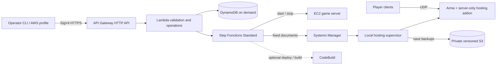

<!-- SPDX-License-Identifier: Apache-2.0 -->
# AWS Arma 3 hosting decision — 10 November 2026

Planning proposal for [#32](https://github.com/instanceofjamie/overlord/issues/32),
read alongside implementation issues #33–#38. No infrastructure or hosting CLI is
implemented by this document. No AWS deployment, Host Havoc change, credential
collection or live campaign migration is authorised by it.

## Recommendation and operator envelope

Use one on-demand x86-64 EC2 instance in **eu-west-2 (London)**, stopped between
sessions, with encrypted retained gp3 EBS and versioned S3 save backups. Start with
**m7a.xlarge (4 vCPU, 16 GiB), zero headless clients**. Benchmark before promising a
player limit. The operator reports **5–10 players, heavily modded Antistasi Ultimate, 10–15
play hours/month**, wants room to grow, and accepts startup delay. Budget and exact
Ultimate release, native extensions, DLC and installed size remain open; the supplied
UAF preset is inventoried below.

Use **Windows Server as the provisional compatibility baseline** until the actual
preset and Antistasi save mode pass Linux acceptance. Prefer Linux after that proof:
it reduces compute cost, but at this usage the saving is only about $3.31/month at
18 billed hours. Avoid risking a campaign for that difference. This is a conservative
design choice, not a claim that Antistasi or all heavy mods require Windows.

The MVP is a separately usable hosting package: `arma-host` below is a **proposed**
CLI name. It requires no director, OVERLORD HTTP service, model API or database.
A small server-only hosting addon and local supervisor provide occupancy/save
integration. OVERLORD can be installed later as an independent optional component.

Estimated envelope with 300 GiB retained storage: **about $36–39/month on Windows**
for the stated usage, **about $30/month completely stopped** with backups/logs
retained. Linux is about $34–35/month. Storage sizing matters much more than a few
idle game hours. These are USD estimates before tax; see the reproducible rates and
assumptions below. No monthly spending ceiling has been agreed.

## Reference project: the operator's Two Small Clouds checkout

The operator identified `/home/j/code/tsc`, inspected read-only at local HEAD
`abd9e1322fe182f9bdf71c1db281df848c645787`. Its configured origin is
`git@github.com:Two-Small-Clouds/tsc-unified.git`. Identification is based on the
supplied checkout, not the earlier name-based search candidate; no commands from
that project were run. Reviewed `README.md`, `online/README.md`,
`online/workflows/site-job.asl.json.tftpl`, `online/buildspecs/provision.yml` and
CodeBuild configuration. [Reference source](https://github.com/Two-Small-Clouds/tsc-unified/tree/abd9e1322fe182f9bdf71c1db281df848c645787/online).

| Reference pattern | Hosting decision |
| --- | --- |
| CLI stages, persisted operation identity, detailed logs on demand | Adopt, with server ID/account/region, operation ID and fresh join address |
| API Gateway/Lambda, workflow manifest in S3, Step Functions, CodeBuild/Terraform, EC2 runtime | Adopt the separation; immutable inputs and bounded asynchronous work |
| Cognito and organisation membership for a hosted service | Use operator AWS credentials + IAM/SigV4 for a control plane in their own account; no hosted multi-tenant service in MVP |
| Provision/deploy/restore/retire workflows | Ordinary start/stop uses EC2/SSM, not a Terraform build each time; destroy is separate from save deletion |
| PHP/Caddy/MariaDB deployment, SSH bootstrap and image pipeline | Arma runs as an OS-supervised game service; SSM management; no database/web stack or mandatory container registry |
| Demo retirement after elapsed time | Replace with continuously confirmed zero **human** occupancy plus save acknowledgement; elapsed time alone is unsafe |

Transfer the architecture and operator experience, not its AWS endpoint, credentials,
state backend, account roles or commercial identity model. Local source may differ
from remote HEAD; the revision above identifies the material inspected.

## Control and network design



Deploy the entire control plane in the operator's account. Lambda stays outside
VPC attachment and calls AWS service APIs. EC2 occupies one public subnet in a small
dedicated VPC with an internet gateway, one auto-assigned public IPv4 while running,
and no Elastic IP by default. Its join address changes after stop/start: `status`
returns the current address only after readiness. EBS ties recovery to its AZ; use
S3 backups to restore into a replacement AZ when capacity is unavailable.

Default game ports: UDP 2302–2306, including query and BattlEye traffic. This cloud
layout is separate from the local same-PC launcher's 2402 port. Allow operator-
specified player CIDRs, expanding only if required; game password and signature
checking supplement the firewall. No inbound SSH, RDP, director API, database or
public RCon. SSM agent uses outbound TLS; Steam also needs its documented outbound
ports/CDNs, so do not assume outbound HTTPS alone suffices. Restrict host firewall
and SG ingress; initially permit necessary outbound internet access rather than
an unreliable static Steam IP allowlist. Require IMDSv2, encrypted volumes, a
non-admin game user and scoped instance role. [Arma server ports](https://community.bohemia.net/wiki/Arma_3:_Dedicated_Server),
[SSM management without inbound ports](https://docs.aws.amazon.com/systems-manager/latest/userguide/session-manager.html).

No NAT gateway, load balancer, bastion, EFS, RDS, paid DNS zone or interface endpoint
fleet by default. A free S3 gateway endpoint is optional. Optional CodeBuild jobs
run **outside** the VPC: VPC-attached CodeBuild cannot obtain a public IPv4 and
would need NAT for internet access. [AWS CodeBuild VPC limitations](https://docs.aws.amazon.com/codebuild/latest/userguide/vpc-support.html).

### Identity and permissions

Use the normal AWS SDK credential chain, preferably IAM Identity Center/SSO or a
short-lived assumed role; `connect` records account ID, region, server ID and API URL,
never long-lived AWS keys. Check STS account identity before every deployment and
before destructive actions. HTTP API uses `AWS_IAM` authorization on **every** route,
including status/log links; signing service is `execute-api`. No shared API key or
reuse of the local director token. [API Gateway IAM authorization](https://docs.aws.amazon.com/apigateway/latest/developerguide/http-api-access-control-iam.html).

| Principal | Required boundary |
| --- | --- |
| Bootstrap/deploy role | Reviewed IaC resources and narrowly scoped PassRole for named stack roles; separate from everyday operator |
| Everyday operator | `execute-api:Invoke` on this API's own server routes; separate inspect/control and force/destroy permissions; no direct admin EC2 rights required |
| API Lambda | Own DynamoDB keys, start/inspect named workflow, own S3 upload prefix; cannot run arbitrary shell or select arbitrary EC2 IDs |
| Workflow role | Start/stop/describe the configured instance; SSM SendCommand only on this instance and fixed versioned documents; scoped status reads; optional named CodeBuild project |
| EC2 role | SSM channels, own log streams and backup prefix; read approved manifests/artifacts; post telemetry only for its configured server; cannot launch instances, delete backups or control other servers |
| Build role, if enabled | Separate reviewed deployment/image permissions and state prefix; never accept an uploaded buildspec or arbitrary repository/ref from game operators |

Some EC2 Describe/list APIs require `Resource: *`; restrict mutations by explicit
ARNs and installation tags and use supported conditions. No blanket `ec2:*`, SSM
shell document or unrestricted `iam:PassRole`. Provisioning may create the one
instance; everyday start cannot create a second. IAM does not isolate malicious
native mods from credentials readable on the same machine: treat installed mods
and extensions as trusted executable code, and keep their role small.

### Asynchronous state and recovery

POST start/stop/update returns **202 + operation ID + polling URL** immediately.
GET server/operation returns desired state, observed EC2 state, game readiness,
phase, timestamps, telemetry freshness, preset digest, last save/backup and error.
Phases: `provisioning`, `downloading`, `awaiting_steam_auth`, `booting`, `ready`,
`saving`, `backing_up`, `stopping`, `stopped`, `failed`/`unknown`. EC2 running is not
Arma ready: require supervised process, mission adapter initialized, fresh occupancy
and a successful query/connection probe. Authentication waits are not readiness.

DynamoDB condition/transaction writes acquire one active operation per server,
store caller idempotency key + request digest, and increment a generation fence.
Same key/same request returns the original operation; changed payload conflicts.
Concurrent incompatible operations return 409. Acquire records before launching a
workflow, use deterministic execution identity, and reconcile a pending operation
if Lambda dies between the two. A short scheduled reconciler checks pending/stuck
operations and EC2 state. Never release an expired lease and launch blindly: inspect
the previous workflow first. TTL is cleanup, not locking. Every SSM command, report
and shutdown intent carries server/boot/mission/generation IDs; stale generations
cannot stop a new session. [DynamoDB conditional writes](https://docs.aws.amazon.com/amazondynamodb/latest/developerguide/Expressions.ConditionExpressions.html).

Use Standard workflows with bounded waits and retries, not a Lambda held open
through boot/download/save. Normal Lambda executions have a 15-minute maximum.
Retry only idempotent steps with backoff; inspect SSM command IDs before resending.
Host supervisor also journals operation IDs so a repeated save/stop request cannot
repeat an unsafe transition. [Lambda timeout](https://docs.aws.amazon.com/lambda/latest/dg/configuration-timeout.html).

Start and downloads have independent deadlines: provisional 20 minutes warm boot,
90 minutes first install/update, with progress and a bounded explicit extension.
If no game has become ready, timeout can stop EC2 and retain partial cache for
inspection. A once-ready server with lost telemetry instead enters unknown and
alerts; it does not become an empty server. Failed save/backup leaves EC2 running,
reports the failure and requires recovery or explicit force-stop. A stopped instance
is reported stopped only when EC2 confirms it. A low-frequency reconciler and error
notification cover workflow failure/host death; no hot standby. Budget alerts are
notifications, not hard caps.

## OS and instance choice

Bohemia supplies a native Linux dedicated server; this is distinct from Linux
player-client/Proton support. Windows clients can join a compatible Linux server,
but version/mod/DLC matching and actual multiplayer acceptance are still required.
PBO/SQF compatibility does not imply extension compatibility: Linux requires
matching x64 `.so` libraries and dependencies, Windows x64 DLLs and runtimes.
Case-sensitive paths and profile locations need explicit tests. Do not mechanically
rename an entire original mod tree: stage a normalized load tree and detect case
collisions. [Native extensions](https://community.bistudio.com/wiki/Extensions),
[dedicated setup](https://community.bohemia.net/wiki/Arma_3:_Dedicated_Server).

Local `bridge/CMakeLists.txt` builds the extension only under WIN32;
`bridge/extension.cpp` uses WinHTTP. This optional director bridge has no Linux
implementation and is not the hosting agent. Keep it out of the baseline preset.
For every actual extension record publisher/version, architecture, OS support,
required runtime/database, signing/BattlEye constraints and a successful load probe.
Use Windows if a required dependency lacks a supported Linux version. No Wine or
Graviton/ARM emulation in the MVP.

Antistasi saving is a specific Linux gate: Community maintainers documented a
Linux `missionProfileNamespace` problem, and closed [#3500](https://github.com/official-antistasi-community/A3-Antistasi/issues/3500)
via [#3532](https://github.com/official-antistasi-community/A3-Antistasi/pull/3532),
a tooltip clarification rather than proof of an engine fix. Do not infer current
compatibility from the closed issue. Test the chosen release and save backend,
including its older profile-based mode where supported. Current Community
[development save code](https://github.com/official-antistasi-community/A3-Antistasi/blob/unstable/A3A/addons/core/functions/Save/fn_saveLoop.sqf)
uses a JSON save path; this does not establish what the operator's release uses.
Ultimate/other forks require their own source audit. No conversion of real saves
until rehearsal under #38.

London shared-tenancy on-demand USD/hour, no SQL or BYOL assumption:

| Candidate | vCPU / RAM | Linux | Windows | Use |
| --- | --- | ---: | ---: | --- |
| m7a.xlarge | 4 / 16 GiB | 0.26806 | 0.45206 | Initial heavy-mod candidate; AMD vCPU mapping gives four physical cores |
| m7i.xlarge | 4 / 16 GiB | 0.23310 | 0.41710 | Cheaper RAM-equivalent Intel comparison; SMT vCPUs |
| c7i.xlarge | 4 / 8 GiB | 0.21210 | 0.39610 | Vanilla/light-mod reference; memory may be inadequate here |
| c7a.2xlarge | 8 / 16 GiB | 0.48784 | 0.85584 | More CPU for future same-host HC; no promise of faster main thread |
| c8i.2xlarge | 8 / 16 GiB | 0.44540 | 0.81340 | Newer-generation comparison if AZ offering/capacity permits |
| z1d.large | 2 / 16 GiB | 0.22000 | 0.31200 | High-frequency older Intel comparison; few threads, ephemeral NVMe is not durable |

Rates are in the evidence file; a priced SKU does not guarantee capacity in a chosen
AZ. Verify offerings/quotas during future planning. Main-thread execution, IPC,
memory latency and mission AI load matter more than vCPU count. Published frequencies
are not Arma benchmarks: [M7a](https://aws.amazon.com/ec2/instance-types/m7a/),
[C7a](https://aws.amazon.com/ec2/instance-types/c7a/),
[z1d](https://aws.amazon.com/ec2/instance-types/z1d/).
Exclude T-family burst credits and Flex baseline variability from the first proof.
No Spot until interruption saves/recovery work. More cores alone do not scale the
main simulation thread.

Benchmark the same Antistasi release/preset with 5 and 10 humans (higher counts as
an explicit stretch test), matching AI/spawn distances, active fights and campaign
progression. Record server FPS distribution, main-thread saturation, RAM peak,
paging, desync and session cost. Provisional acceptance: sustained heavy combat
should avoid server FPS below 20 and memory pressure; operator confirms playability.
Measure rather than advertise a capacity. Start HC count at zero; later compare one
on the same host before paying for a second EC2. HCs only help when the framework
transfers AI locality and recovers it on disconnect; use identical mods and narrowly
allowed HC addresses. [Bohemia HC guide](https://community.bistudio.com/wiki/Arma_3_Headless_Client?useskin=darkvector).

## Preset, Steam and release workflow

The supplied `Arma 3 Preset UAF.html` was inspected offline on 10 November: **54
mod rows, 54 unique valid Workshop IDs, no duplicate IDs or local-only rows**.
[Inventory and source SHA-256](evidence/2026-11-10-uaf-preset-inventory.json) preserve
its order and labels without publishing the operator's full HTML. It includes
Ultimate `3020755032`, CUP terrains/units/vehicles/weapons, RHS families, Ukraine
faction packs, drones/EW, Zeus Enhanced, Ares and cosmetic/audio mods. This is a
substantial mod set, not an installed-size measurement or a complete server preset.

Review Blastcore, JSRS and Post Process Effects as likely client-only candidates;
verify publisher guidance before excluding them. Review Ares plus Zeus Enhanced,
multiple faction/extender packages and their requirements against Ultimate's
supported set. An Ultimate “Extender” is not evidence of a native DLL: inspect
actual files and publisher dependencies. Do not silently drop an unavailable item,
substitute a same-named reupload or resolve every client mod onto the server.
The Workshop HTML responses contain generic removal/incompatibility banners even
alongside populated descriptions: unauthenticated page text alone is not proof of
download entitlement or removal. Validate all 54 IDs using SteamCMD in #34.

Parse HTML as data with size/row limits, no browser or script execution and no URL
fetches from the document. Accept only canonical Steam Workshop links with one
positive numeric ID; preserve first-seen order and report duplicates, malformed
links, missing dependencies and local paths. Store a reviewed deployment manifest
with preset hash and explicit `client`, `shared`, `server-only` overrides. Resolve
Workshop dependencies with operator review; the HTML is not a lockfile and does not
encode server settings, release versions, signing trust or save backend.

Use server app **233780** and Workshop parent **107410**. At an interactive SteamCMD
prompt the intended sequence is `force_install_dir <staging-dir>`, `login <account>`,
`app_update 233780 validate`, then `workshop_download_item 107410 <id> validate` per
reviewed ID. Do not promise anonymous access or identical entitlement for server
files and Workshop content. Bohemia describes a separate account for the server;
Workshop access/ownership must be proven with this preset. Budget a separate owned
copy if required; no account purchase is included in AWS estimates.
[Bohemia installation instructions](https://community.bohemia.net/wiki/Arma_3:_Dedicated_Server).

Keep Steam Guard enabled. Bootstrap authentication interactively over a private SSM
session, with secret entry excluded from session content logging. Never pass a
password/Guard code in CLI arguments, user-data, build logs, Terraform variables or
state. Retain restricted SteamCMD auth/config on encrypted EBS, separate from game
readable data and ordinary campaign backups; cached tokens are credentials. Valve
documents preserving `config/config.vdf` for subsequent token logins in its SteamPipe
CI workflow; Arma Workshop reuse remains an empirical gate and tokens may expire.
Surface `awaiting_steam_auth` with a bounded wait and operator renewal, not infinite
retries or a requirement to disable MFA. No concurrent account login jobs.
[Valve token workflow](https://partner.steamgames.com/doc/sdk/uploading?l=english#5).

MVP installs under the host supervisor using the retained Steam cache. Updates are
explicit while game/HCs are stopped, never mid-session. Stage downloads separately,
check item completion, disk space, dependencies, accepted `.bikey` fingerprints and
native extension loading; promote one manifest atomically after validation. Record
server build ID, Workshop timestamps/manifests where available, content hashes,
ordered arguments and approved key set. Download failure leaves the last known-good
release intact and prevents readiness for the requested new release. Existing
cached release can start without contacting Steam if the operator chooses it and
clients still match. Keep a tested rollback copy only if storage allows.

Workshop IDs/manifests do not guarantee that old bytes remain downloadable. A local
archive can support rollback subject to mod licences and client versions; no public
redistribution or unlimited historic-version promise. [BrettMayson/Arma3Server](https://github.com/BrettMayson/Arma3Server)
is a useful preset/cache implementation reference, but its automatic restart updates
and documented disabled-Guard setup are not the chosen policy.

CodeBuild is optional for packaging the supervisor, IaC validation and later base
image builds. Local reviewed Terraform is the simplest bootstrap; an optional
CodeBuild deployment project can run a fixed reviewed plan in this same account,
with S3 state locking and a separate deploy role. Bootstrap must create its project
and roles first. Builds produce pinned artifacts; AMI creation also requires a
temporary EC2 builder and retained EBS snapshots, with separate costs and cleanup.
Do not bake Steam tokens or live saves into AMIs. No golden image/ECR requirement in
MVP; retained installs avoid re-downloading heavy mods. CodeBuild never hosts the
live game or serves as the player-idle timer.

## Durable state and safe shutdown

Use 60 GiB root + 240 GiB data as a **300 GiB sizing assumption**, not a measured
minimum. Data holds game install, approved mod cache, staging space, missions,
profiles, campaign saves and supervisor journal. Allocate roughly 150 GiB mods,
40 GiB game, 20 GiB durable state and 30 GiB staging on data; large updates or two
complete mod generations can exceed this. Check actual bytes/free space before
installation and enlarge deliberately. Sparse files still incur full provisioned
EBS cost. Data volume has `DeleteOnTermination=false`, IaC prevent-destroy/retention
and explicit mount verification; a missing mount fails closed rather than creating
an empty new campaign on root.

Map **all actual write paths**, not just `MPMissions`: profile and vars files,
mission-specific directories, configs, mod databases and any client-side persistence
that needs a separate export. Fix profile name, campaign ID, map, save backend and
release identity in the manifest. On Linux bind the game user's actual home profile
paths to durable storage; do not assume `-profiles` behaves like Windows. S3 is a
backup store, not a live filesystem. EC2 stop retains EBS, erases instance-store
data and does not persist RAM. [AWS stop/start semantics](https://docs.aws.amazon.com/AWSEC2/latest/UserGuide/Stop_Start.html).

The operator confirmed **Antistasi Ultimate**; exact release still needs pinning.
Its [maintainer FAQ](https://github.com/Antistasi-Ultimate-Community/A3-Antistasi-Ultimate/wiki/FAQ#where-are-saves-located)
identifies profile vars or `AntistasiUltimate.vars` save files. Reviewed upstream
[saveLoop](https://github.com/Antistasi-Ultimate-Community/A3-Antistasi-Ultimate/blob/b01fa3c285f9f38aa5fed2f6f36e81a680873268/A3A/addons/core/functions/Save/fn_saveLoop.sqf)
is server-only, guards overlapping saves with `savingServer`, selects profile or
mission-profile namespaces, and waits for client save data with a timeout. These
are integration leads, not a stable external API or evidence for the installed
version. At this upstream revision it writes the selected namespace, triggers
`CBA_EVENT_SERVER_GAME_SAVED`, then clears the guard. Audit those hooks and the
disconnect-save path at the selected release; that event alone cannot prove
filesystem durability or complete player-plugin data after a timeout. A fresh save with zero humans must retain the last connected
players' progression, not just world state. Prototype on disposable test campaigns.

Provide a versioned adapter contract: `capabilities`, `occupancy`,
`prepare_save(operation_id)`, `save_result`, `shutdown`. Invoke a fixed allowlisted
save function in authoritative server context; never accept arbitrary SQF from API
requests. Hook actual completion/error paths with an operation-correlated result,
validate expected files and flush, and preserve an earlier generation. Merely
calling `saveProfileNamespace` only writes variables already placed in that
namespace; it does not collect campaign state. `persistent=1` keeps a mission alive,
not durable. `#shutdown` exits; it is not a universal campaign save.
[Profile persistence](https://community.bohemia.net/wiki/profileNamespace),
[shutdown semantics](https://community.bistudio.com/wiki/Multiplayer_Server_Commands).

Order for both normal CLI stop and idle stop:

1. Acquire the lifecycle lock and current generation. Announce maintenance; idle
   stop rechecks live occupancy and fences admissions before commitment. A reconnect
   before commitment cancels idle stop; after commitment refuse new joins briefly
   with a clear reason. Test lobby and in-flight connections, not just spawned units.
2. Request mission save; wait for correlated success and expected disk evidence
   (provisional 120-second deadline). Serialize against native autosave. Unsupported
   adapter, timeout or failed player/world save blocks normal stop and alerts.
3. Gracefully end game and HCs; prevent the service manager from restarting them.
   Flush/quiesce files, upload a checksummed versioned backup and manifest to private
   S3. Validate upload success before stopping EC2. Failed backup leaves the instance
   running in maintenance for retry; never claim successful graceful stop.
4. Stop EC2; poll until stopped, record cause/save/backup IDs and billed duration.
   Preserve EBS. Explicit `--force --ack-unsaved` bypasses failed save/backup only
   after reporting known risk; it never deletes saves. Record an uncertain/crash
   outcome, not a successful saved stop.

Use encrypted private versioned S3 (block public access, TLS-only, SSE-S3 default),
immutable backup names, checksums and manifest/version IDs; game role cannot delete
old backups. Retain a bounded set such as last 10 completed saves plus weekly copies
for four weeks, implement lifecycle for noncurrent versions and incomplete multipart
uploads, and monitor bytes. A 20 GB aggregate retention allowance is costed below;
retention count alone does not bound bytes. Daily/session checkpoints bound potential
loss if process/instance fails before final save. Target campaign RPO one completed
checkpoint (provisionally 15 minutes during play), RTO 1–2 hours from S3, both unproven.
EBS retention alone is neither backup nor protection against corruption/deletion.
Restore always targets an isolated copy first and requires a real reload test.

### Human occupancy and the 30-minute rule

Select server-authoritative `allUsers` + `getUserInfo` and its explicit `isHeadless`
field as the primary source, with connect/disconnect events for quick reset and
periodic full reconciliation. Count every connected non-HC human, including lobby,
dead, spectator and admin users. Do not use living units, CPU/network quietness or
subtract the configured HC count from A2S totals. Missing/partial user records make
the sample unknown. [allUsers](https://community.bistudio.com/wiki/allUsers),
[getUserInfo field layout](https://community.bistudio.com/wiki/getUserInfo).

A server-only addon emits schema-validated snapshots every 15 seconds, with boot,
mission, sequence and operation generation IDs. A local tailer can consume dedicated
structured RPT markers without a native extension; require fresh markers and test
buffering/rotation. Prefer a dedicated channel if RPT cannot meet freshness bounds.
Any control messages back into SQF require a fixed local adapter transport, to be
proved under #33/#36 (e.g. a narrow reviewed cross-platform extension). Do not expose
remote debug console/RCon as an arbitrary-code bridge. Authenticate host reports
with the instance role; validate server/instance identity in Lambda and omit player
UIDs/names from logs. A2S_INFO/BattlEye can corroborate reachability/roster, but are
not chosen as the sole human/HC discriminator.

Maintain a monotonic local zero-human interval. Only start it after readiness and
startup grace (provisional 10 minutes); a fresh continuously confirmed zero interval
of **1,800 seconds** is required. A human resets it; a heartbeat gap over 45 seconds,
mission/boot change or uncertain roster resets it to unknown and requires a new
interval. At 1,740 seconds remain running; at 1,800 request the fenced save/stop
sequence, never before. Recheck immediately before commitment; timers must not
survive into a different session. `hold-open --for 2h` suppresses idle stop until
its explicit expiry; status shows both hold expiry and effective timer. Use real
elapsed time, not accelerated mission time. Telemetry failure alerts within two
minutes and remains running; a separate startup-failure watchdog stops failed
never-ready boots. No automatic force-stop of a once-ready unknown server.

## Costs: London, retrieved 10 November 2026

Rates are from AWS public regional offer CSVs, selected rows and publication dates
in [price evidence](evidence/2026-11-10-aws-london-prices.json). EC2 offer published
7 November, effective 1 November. Prices can change; recalculate before apply.
USD, shared-tenancy on-demand, Windows licence included, no discounts, credits,
Savings Plans, VAT, exchange-rate conversion, paid support or Steam licence cost.
Use a 730-hour month for comparison. Primary rate sources: [EC2](https://pricing.us-east-1.amazonaws.com/offers/v1.0/aws/AmazonEC2/current/eu-west-2/index.csv),
[S3](https://pricing.us-east-1.amazonaws.com/offers/v1.0/aws/AmazonS3/current/eu-west-2/index.csv),
[VPC IPv4](https://pricing.us-east-1.amazonaws.com/offers/v1.0/aws/AmazonVPC/current/eu-west-2/index.csv),
[CloudWatch](https://pricing.us-east-1.amazonaws.com/offers/v1.0/aws/AmazonCloudWatch/current/eu-west-2/index.csv),
[transfer](https://pricing.us-east-1.amazonaws.com/offers/v1.0/aws/AWSDataTransfer/current/eu-west-2/index.csv).

| Item / assumption | Stopped month | Variable running cost |
| --- | ---: | ---: |
| 300 GiB gp3 at $0.0928/GiB-month; included 3,000 IOPS / 125 MiB/s, no extras | $27.84 | Same provisioned charge |
| S3 Standard 20 GB aggregate backups/artifacts at $0.024/GB-month | $0.48 | 1,000 PUT/LIST + 10,000 GET adds $0.0095/month |
| CloudWatch 1 GB ingested/month, 14-day retention, conservative 0.5 GB-month stored | Stored tail ≤$0.016 | $0.5985 ingestion + $0.01575 storage ≈ $0.61/month with sessions |
| Public IPv4 auto-assigned, released on stop | $0 | $0.005/hour |
| Control services and error notification allowance | $1/month | Same $1 allowance at this small usage, not a measured bill |
| EC2 m7a.xlarge | $0 | Linux $0.26806/hour; Windows $0.45206/hour |
| Internet transfer | $0 if no traffic | 50 GB/month assumed game/log outbound; $0 if shared 100 GB allowance remains, otherwise $4.50 at $0.09/GB |

50 GB is a budgeting assumption, not an Arma bandwidth benchmark. Incoming Steam
content is free internet ingress; same-region EC2/S3 backup transfer has no ordinary
transfer charge. Avoid cross-AZ backup relays and cross-region replicas. The 100 GB
internet allowance is account-wide across services/regions; do not count it twice.
[AWS transfer terms](https://aws.amazon.com/ec2/pricing/on-demand/).

Model **four sessions/month**, 15 minutes total startup/grace/save work plus 30 minutes empty
per session: **13–18 billed hours** for 10–15 play hours. More shorter sessions
increase overhead. Fully stopped fresh month (no new ingestion/builds/requests) is
about **$29.32–29.34**; for comparison carry all active-month allowances below as
**$29.94 fixed** including the full log allowance and requests.

| Monthly scenario | Estimated total incl. active-month allowances, 50 GB outbound within shared free allowance |
| --- | ---: |
| Retained EBS, Linux, 13 / 18 hours | $33.49 / $34.86 |
| Retained EBS, Windows, 13 / 18 hours | $35.88 / $38.17 |
| Retained EBS, 730 hours Linux / Windows | $229.27 / $363.59 |
| Disposable Linux, 18 hours, 150 GB S3 mod cache + 20 GB backups, 300 GiB temporary EBS only while running | about $11.31 |
| Disposable Windows, same assumptions | about $14.62 |

Formula retained = $29.94 + hours × (OS EC2 rate + $0.005 IPv4). Marginal billed
Windows game-hour is $0.45706; active EC2+IPv4+pro-rated EBS is about $0.49520/hour,
but retained EBS is payable all month. Add $4.50 if all assumed outbound is billable;
200 GB outbound with the entire shared allowance available costs $9 instead of $0.
If storage grows to 500 GiB, add **$18.56/month**. An optional Elastic IP retained
for the whole month costs **$3.65**, replacing the hours-only IPv4 charge. Avoid it
by default. A warm install can exceed 15 minutes and first install costs extra:
allow $1–3 for a few additional Windows hours, more if downloads stall.

The disposable estimate is a cost alternative, not an implementation promise:
$3.60 mod cache + $0.48 backups + $0.61 logs + $1 control + $0.0095 requests +
$0.6865 temporary EBS + 18 × EC2/IPv4. No retained root disk, AMI snapshots or EIP;
no extra cold-restore hours included. Cache is same-region private S3, compressed
size assumed 150 GB, not measured. It saves about $23.55/month at this usage but
adds restore/auth/update/cleanup complexity and risk of lost unsaved state. With
startup patience it is a worthwhile **second phase after restore drills**, not a
reason to skip the retained-server proof. Delete temporary disks only after a
verified durable backup; keep orphan cleanup and failure recovery explicit.

The $1 control allowance assumes ≤10,000 small API/Lambda calls, ≤20,000 DynamoDB
write units + 100,000 reads and <0.01 GB stored, ≤2,000 Standard workflow transitions,
and a low-rate reconciler with small payloads. At fetched London DynamoDB rates
these requests are about $0.030 before storage; the allowance covers API, Lambda,
workflow, scheduling and notifications but must be replaced by actual metering in
#33/#35. No provisioned concurrency/capacity or custom dashboards/metric fleet.
[API pricing](https://aws.amazon.com/api-gateway/pricing/),
[Lambda](https://aws.amazon.com/lambda/pricing/),
[workflow](https://aws.amazon.com/step-functions/pricing/),
[DynamoDB](https://aws.amazon.com/dynamodb/pricing/).

Optional CodeBuild general1.small in London is $0.005/minute: 60 build minutes adds
$0.30 before any free tier; AMI builder EC2 and snapshot storage are additional.
Ordinary sessions use zero CodeBuild minutes. Snapshot/image costs are **not** hidden
inside the stopped MVP price; MVP uses file backups and no custom AMI. Default AWS
managed EBS encryption and SSE-S3 avoid a customer-managed KMS key's standing fee.
Keep logs redacted/bounded; AWS retention limits storage, not ingestion. No cost
claim includes standing NAT, ALB or paid VPC endpoints because none is proposed.

## First-time and everyday operator steps

This is the intended runbook for #33–#36. **Only the AWS identity inspection below
is usable now; `arma-host` commands are a proposed interface, not installed tools.**
Do not copy these as a deployment recipe until the implementation PR supplies IaC,
role policy documents, reviewed plan output and tested save adapter.

1. Inventory Ultimate release, map, preset, server settings, profile/campaign/save
   backend and extensions. The supplied UAF HTML establishes the 54-ID starting
   inventory. Resolve required items and server/client overrides; do not export,
   move or overwrite Host Havoc data in this planning phase.
2. Later, install AWS CLI v2/SSM plugin and the separately packaged hosting CLI.
   Configure an SSO/assume-role profile in the chosen account. Inspect identity:

   ```sh
   aws sso login --profile arma
   aws sts get-caller-identity --profile arma
   ```

   Proposed `arma-host connect --profile arma --region eu-west-2` verifies and
   displays account/region, stores nonsecret local config and checks prerequisites.
   Check region/AZ instance offerings, quota, allowed player CIDRs and budget alerts.
3. Proposed `arma-host deploy --plan` generates reviewed Terraform for control and
   host resources, retention settings, least-privilege roles and the cost estimate.
   Bootstrap state/backend with the deploy role, locking and restricted access;
   never share TSC state. A separately authorised `deploy --apply <plan>` creates
   the reviewed resources. No fleet/account discovery is needed. Keep ordinary
   operator credentials separate; destroy data is a separate privileged operation.
4. Upload preset through `arma-host mods import '<preset.html>' --plan`; review
   classification/dependencies, disk requirement and key/extension trust report.
   Stage approved manifest via an expiring, exact-prefix S3 upload capability.
   `mods sync` boots maintenance mode, performs install and stops after success or
   a bounded failure. It must never boot an unconfigured empty campaign as ready.
5. `arma-host steam login` opens a private SSM interactive flow; enter credentials
   and Steam Guard at the host prompt. Verify server download and one then all
   required Workshop items. Preserve private auth state; no disabling Guard or
   asking the control API to collect it. If unavailable, stop with an actionable
   authentication state and continue later.
6. Install a **new test campaign**, configure fixed profile/save paths and adapter.
   `arma-host start --wait` returns staged progress and a join address after readiness.
   Join using current client preset; record actual startup time, memory, server FPS
   and billed time. Keep server-only hosting addon independent of the director.
7. Save meaningful test changes, `arma-host stop --wait`, then start and verify
   Ultimate world **and player** progression. Restore the S3 backup into isolated
   storage and verify again. Test interrupted download, failed save/upload,
   telemetry loss, zero/HC-only/lobby occupancy, reconnect and generation fencing.
   Enable idle-stop only once these pass for the selected Ultimate release.
8. Everyday: `start`, `status`, `operations show <id>`, `logs --since 15m`,
   `hold-open --for 2h`, `stop --wait`. Status shows humans/HCs, freshness, hold,
   idle deadline, last save/backup, cost assumptions and address. Updates require an
   explicit stopped/maintenance operation; automatic latest-at-every-boot is off.
9. Recovery: `status` identifies active workflow/SSM command and error. Resume or
   cancel that operation rather than starting another. Renew Steam auth when
   requested; retry failed backup from retained disk. If EBS/host fails, launch a
   replacement from the manifest and restore a selected S3 generation, never run
   two writers against the same campaign. Use an isolated restore before replacement.
10. `destroy --keep-data` removes compute/control/network resources but exports a
    recovery manifest and retains data EBS + backup bucket, clearly listing remaining
    charges. An EC2 instance may still be running after failed normal stop: destroy
    must save/stop or explicitly require the force acknowledgement first. A separate
    `data purge --plan` lists exact volume/snapshot/bucket versions and requires a
    deliberate account/server-specific deletion acknowledgement. Ordinary destroy
    never empties campaign backups. Full teardown also removes build artifacts,
    optional AMI snapshots/EIPs and log groups only when explicitly selected.

## Implementation order and decision gates

| Issue | Deliverable and evidence before progressing |
| --- | --- |
| [#32](https://github.com/instanceofjamie/overlord/issues/32) | Review this design and operator assumptions; choose budget/storage, pin Ultimate release, map and save backend; this PR does not close compatibility/performance criteria |
| [#33](https://github.com/instanceofjamie/overlord/issues/33) | Authorised IaC proof on one retained on-demand server, SSM/supervision, independent addon/adapter, real join/save/stop/start and isolated restore; compare OS candidates with actual preset |
| [#34](https://github.com/instanceofjamie/overlord/issues/34) | 54-ID UAF import, reviewed dependencies/overrides, Steam Guard renewal, staged updates and cache retention; test native extensions and signature checks |
| [#35](https://github.com/instanceofjamie/overlord/issues/35) | Standalone authenticated CLI/API, bounded workflow, idempotency/concurrency and partial-failure recovery; formalise role policies and replace cost allowances with metering |
| [#36](https://github.com/instanceofjamie/overlord/issues/36) | 29/30-minute boundary, HC-only, lobby/dead/spectator, reconnect, hold expiry, telemetry loss/restart, save and backup failure, admission race, stale-generation tests |
| [#37](https://github.com/instanceofjamie/overlord/issues/37) | Optional zero-vs-one HC benchmark, disconnect/locality recovery and actual cost; higher player-count acceptance |
| [#38](https://github.com/instanceofjamie/overlord/issues/38) | Only after separate authorisation: rehearse copies of live campaign data, compare actual costs/performance with Host Havoc; operator decides any cutover |

#33 can begin with vanilla scaffolding, but does not establish modded acceptance
until #34 completes. #35 may develop against mocks while that proof runs. No later
issue is implicitly authorised to provision because this planning PR exists.

Unresolved decisions: the installed Ultimate release/map/save mode; exact required
native extensions and dependencies after the preset audit; installed/cache/update
sizes; maximum desired player count; budget cap; whether disposable restore's idle
savings justify its complexity. No numeric startup SLA was requested. Provisional
boot/download deadlines are operational watchdogs, not a performance promise.
Windows is the provisional baseline; Linux promotion requires save/reload and
representative modded gameplay, not a successful server process launch.

Validation for this planning work: repository README, architecture/FinOps and issues
#32–#38 read; no AGENTS.md found in this repository or ancestor instruction paths.
Current local dedicated evidence and Windows-only bridge inspected without changing
them. Exact TSC checkout read-only, launcher HTML parsed offline, public primary
sources checked and selected regional prices retained. No AWS account queries,
Steam authentication/downloads, game starts, infrastructure apply or live data
migration were performed. Runtime, IAM and game integration validation remain the
explicit gates above.
